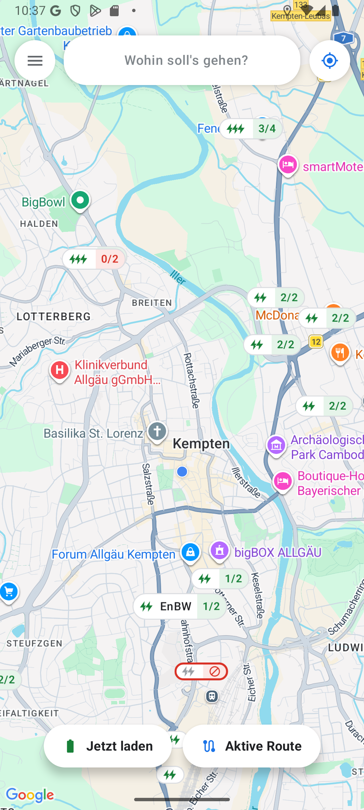
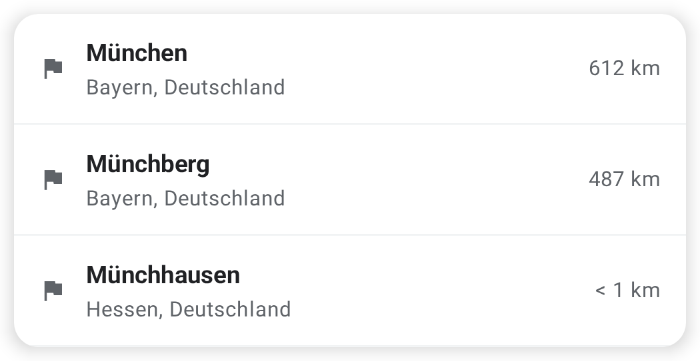
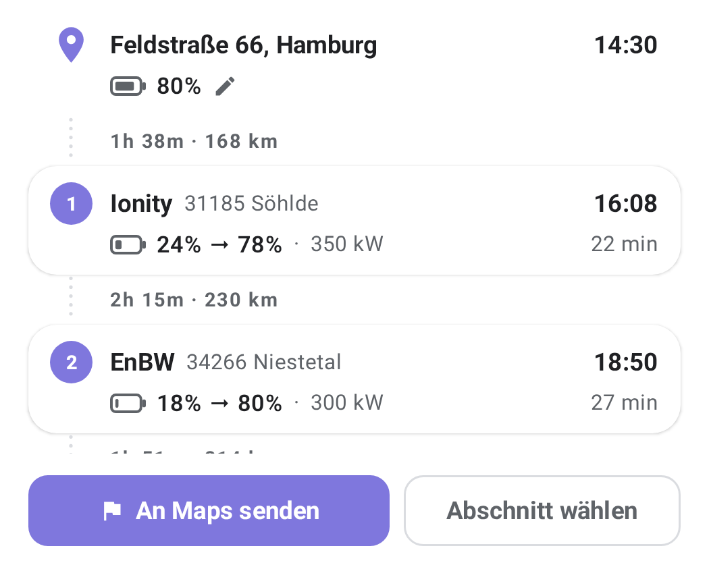
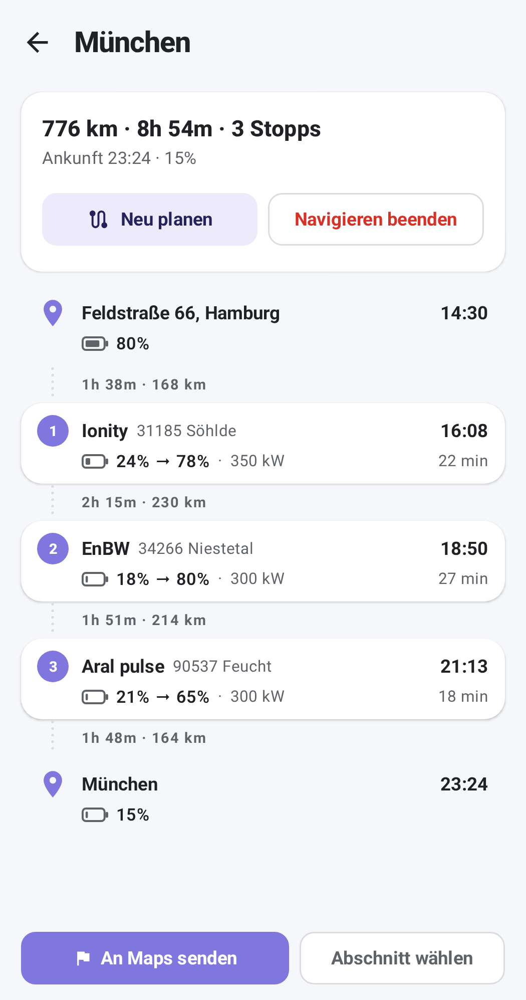

<div align="center">

# ⚡ PowerTrip

**Plan your EV road trip — charging stops included.**

Pick a destination, get the charging stops that fit your car and battery,
and drive it with Google Maps. Also on Android Auto and CarPlay.

[](https://github.com/kalinjul/PowerTrip/actions/workflows/ci.yml)


</div>

<table align="center">
  <tr>
    <td valign="top" width="25%"></td>
    <td valign="top" width="25%"></td>
    <td valign="top" width="25%"></td>
    <td valign="top" width="25%"></td>
  </tr>
  <tr>
    <td align="center"><sub><b>Chargers around you</b></sub></td>
    <td align="center"><sub><b>Search a destination</b></sub></td>
    <td align="center"><sub><b>Get the charging stops</b></sub></td>
    <td align="center"><sub><b>Drive the active route</b></sub></td>
  </tr>
</table>

---

## Features

| | |
|---|---|
| 🔎 **Plan a trip** | Type a destination in the search bar; the route and its charging stops appear in a sheet over the map — arrival charge level, charge window and times per stop. |
| 🚗 **Your car, your numbers** | A garage of vehicle profiles, picked from the catalog or typed in (battery, consumption, connectors, DC peak power), plus the current charge level. Without them, reachability stays open instead of being guessed. |
| 🧭 **Navigate with Google Maps** | Send the whole route, one section, or a single stop to Google Maps. The sent trip stays the active route until you end it, and can be re-planned on the way. |
| 🗺️ **Chargers on the map** | Charging stations around you with live availability, ad-hoc prices and a filter for power, distance and charging networks. |
| ⚡ **Charge now** | The three best chargers nearby. If none fit, the filter relaxes step by step: power → networks → distance. |
| 🖥️ **In the car** | Android Auto brings the planned route, destination search, charge now and the charge level onto the car's screen — using the car's own battery reading where the head unit provides one. CarPlay is to follow. |
| 🌍 **English and German** | The app follows the phone's language. |

## Getting started

**Prerequisites:** JDK 17 or newer, an Android SDK with Platform 37,
and access to the ChargeAhead backend.

1. Put the SDK path and the backend into `local.properties` (git-ignored):

   ```properties
   sdk.dir=/path/to/Android/Sdk
   chargeAheadBaseUrl=https://YOUR_HOST
   chargeAheadToken=YOUR_TOKEN
   googleMapsApiKey=YOUR_MAPS_KEY
   ```

2. Add the Maven access for the backend's contract module to
   `~/.gradle/gradle.properties`:

   ```properties
   chargeahead.maven.user=…
   chargeahead.maven.password=…
   ```

3. Build and install:

   ```bash
   ./gradlew :androidApp:installDebug
   ```

Without backend address and token the app stops at startup; without a Maps
key it says so in place of the map. For iOS, the same values go into
`iosApp/Secrets.xcconfig` — see [iosApp/README.md](iosApp/README.md).

## Testing

```bash
./gradlew testAll
```

That runs the shared unit tests, the car screen tests, the Robolectric UI tests
and the screenshot comparison. The screenshot step needs Docker or Podman: goldens only match where they
were rendered, so `tools/screenshots.sh` validates and records them in the
Linux container CI uses (`update` to re-record, then look at the PNGs; details
in [docs/testing.md](docs/testing.md)). The backend mapping can additionally
be checked against the real service:

```bash
CHARGEAHEAD_LIVE=1 ./gradlew :shared:jvmTest --tests '*BackendChargeSiteLiveContractTest'
```

Android Auto only runs on real hardware; the Desktop Head Unit makes it
testable from a desk (`tools/start-dhu.sh`). Swift can only be syntax-checked
on Linux (`tools/check-swift.sh`); on a Mac, `tools/ios-sim.sh run` builds the
iOS app and starts it in the simulator.

## Documentation

| Document | Covers |
|---|---|
| [ARCHITECTURE.md](ARCHITECTURE.md) | Design, platform constraints, data sources |
| [ROADMAP.md](ROADMAP.md) | Milestones, planned UI, open points |
| [AGENTS.md](AGENTS.md) | Working rules for agents and humans |
| [docs/shared/](docs/shared/domain-model.md) | The shared code: model, data layer, use cases, assembly |
| [docs/testing.md](docs/testing.md) | Test layers, screenshot goldens |
| [docs/android-auto-testen.md](docs/android-auto-testen.md) | The app in the Desktop Head Unit |
| [docs/ci-cd.md](docs/ci-cd.md) | CI, Play Store releases, secrets |
| [iosApp/README.md](iosApp/README.md) | What to do on a Mac |
| [brand/README.md](brand/README.md) | Logo sources and where they end up in the app |
